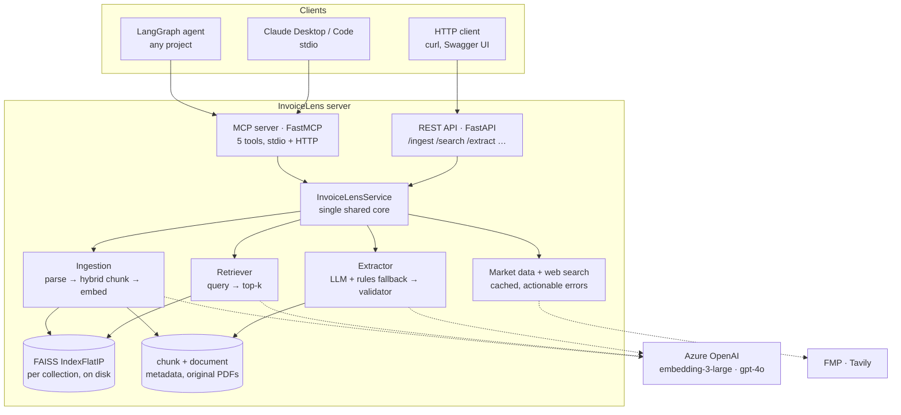
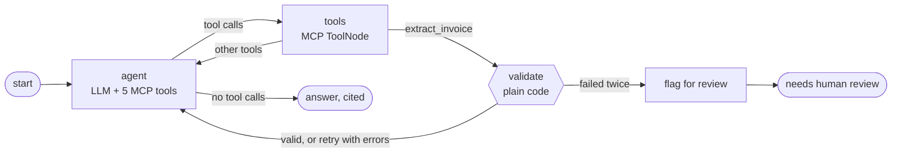

# InvoiceLens MCP

[](https://github.com/rohitjondhalems/invoicelens-mcp/actions/workflows/tests.yml)

An MCP server for invoice PDFs and vendor research. It exposes five tools that any MCP client can use: a LangGraph agent in another project, Claude Desktop, or Claude Code.

| Tool | What it does |
|---|---|
| `invoicelens_ingest_document` | Parses a PDF, **hybrid-chunks** it (tables, header fields, totals and prose handled separately), embeds the chunks with `text-embedding-3-large` and stores them in **FAISS** |
| `invoicelens_search_documents` | Semantic search across everything ingested; returns passages with `doc_id`, filename, page and score |
| `invoicelens_extract_invoice` | Reads one invoice into a typed schema, then **validates the arithmetic** (line items vs subtotal, subtotal + tax vs total, tax rate, dates) |
| `invoicelens_company_financials` | Share price, market cap, sector, CEO and 3 years of revenue, net income and EPS growth for a listed company ([Financial Modeling Prep](https://site.financialmodelingprep.com)) |
| `invoicelens_web_search` | Current web results with source URLs and dates: news, growth, strategy ([Tavily](https://tavily.com)) |

The same operations are also exposed as a REST API (`/ingest`, `/search`, `/extract`, `/company-financials`, `/web-search`) from the same process, backed by the same index.

## Architecture



Both interfaces are thin adapters over one `InvoiceLensService`, so they can't drift apart. A test asserts that MCP and REST return identical results for the same call.

### The agent graph (`agent/`)



The `validate` node is deterministic code, not an LLM. When an extraction fails the arithmetic checks, it sends the exact errors back to the agent ("Line items sum to 5,700.00 but subtotal is 5,900.00"). The agent then re-extracts with that `feedback`. If the second attempt also fails, the graph stops and flags the invoice for human review, rather than letting the agent present numbers that don't add up. Some invoices really are wrong; `samples/initech_*` is one.

## Vendor research: market data and web search

Two tools look outward, so an agent can go from "who sent this invoice?" to "what do we know about them?"

| Question | Tool | Why this one |
|---|---|---|
| "What's Microsoft's market cap / share price / revenue growth?" | `invoicelens_company_financials` | Structured, dated numbers from a market-data API |
| "How is the company growing? Any recent news?" | `invoicelens_web_search` | Recent context with source URLs |

Numbers deliberately don't come from web search: snippets can be days old or quote the wrong currency. The tool descriptions and the agent's system prompt both steer the model to the right tool.

**Setup.** Both keys are optional; without one, its tool returns a clear "set INVOICELENS_…_API_KEY" error and everything else keeps working.

```bash
INVOICELENS_TAVILY_API_KEY=tvly-...      # https://app.tavily.com
INVOICELENS_FMP_API_KEY=...              # https://site.financialmodelingprep.com
```

```bash
curl "http://127.0.0.1:8765/company-financials?company=Microsoft"
curl -H 'content-type: application/json' -d '{"query":"Microsoft cloud growth","topic":"news","time_range":"month"}' \
     http://127.0.0.1:8765/web-search
```

**Know the free tiers** (as of October 2026):

- **FMP:** 250 calls a day, and **US-listed securities only**. Non-US companies resolve through a US listing where one exists (Infosys → `INFY` ADR); otherwise they need a paid plan. Name searches prefer US exchanges for this reason. Lookups are cached for 10 minutes (one company costs 2–3 calls), and if the growth endpoint isn't in your plan, the profile still returns with a note.
- **Tavily:** 1,000 credits a month on the free tier. Each search uses one credit (`search_depth: basic`).
- **Private companies**, like the fictional vendors in `samples/`, aren't listed. The financials tool says so and points the agent to web search instead. To demo the market tools, ask about a real US-listed company.

Market data is returned with its source, `retrieved_at` timestamp and a "not investment advice" note, and the API key travels in a header, never in the URL.

## Hybrid chunking

A pure fixed-size splitter cuts invoices in the worst places: through a line-item table, or between `Invoice Number:` and its value. A pure structural splitter makes wildly uneven chunks. InvoiceLens does both, in order.

**1. Structure.** Each page's elements are classified in reading order:

| Element | Becomes |
|---|---|
| Table | Its own chunk, as a markdown table. Never split mid-row; oversized tables split by rows with the header repeated in each piece |
| `Subtotal / VAT / Total` block | A `totals` chunk, which is what "how much" queries need |
| Vendor, address, invoice no., dates, bill-to | Merged into one `header` chunk, so matching metadata stays together |
| Short title line | Not a chunk; becomes the `section` of the chunks after it |
| Paragraphs | Go to step 2 |

**2. Size.** Prose is packed into windows of at most 512 tokens with 64 tokens of sentence-level overlap. Sentences are never cut unless a single sentence exceeds the window.

Every chunk is embedded with a contextual header (`Document: acme.pdf | Page 1 | totals | Section: …`), so a terms paragraph is still findable by its vendor.

On the samples, every invoice produces `header → table → totals → text`. The Northwind terms page (about 180 tokens) is one `text` chunk under `Section: Terms and Conditions`; longer documents are windowed with overlap (see `test_long_prose_is_windowed_with_overlap`).

## Quick start

```bash
pip install -e ".[agent,dev]"
cp .env.example .env              # add Azure OpenAI details for real embeddings + LLM extraction
invoicelens-serve                 # REST + MCP on http://127.0.0.1:8765  (Swagger at /docs)
```

```bash
curl -F file=@samples/northwind_logistics_2026-04.pdf http://127.0.0.1:8765/ingest
curl -H 'content-type: application/json' -d '{"query":"late payment penalty"}' http://127.0.0.1:8765/search
```

With no keys set, InvoiceLens runs fully offline using a hashing embedder and a rule-based extractor. That's how the tests and CI run, and why the server always starts. The hashing embedder is lexical, not semantic, so use Azure OpenAI for real retrieval quality. `/health` reports which providers are active.

## Use it from another project

That project needs no InvoiceLens code. It only needs the server's URL and `langchain-mcp-adapters`:

```python
from langchain.agents import create_agent          # pip install langchain langchain-mcp-adapters
from langchain_mcp_adapters.client import MultiServerMCPClient

client = MultiServerMCPClient({
    "invoicelens": {
        "url": "http://127.0.0.1:8765/mcp",
        "transport": "streamable_http",
        # "headers": {"Authorization": "Bearer <INVOICELENS_API_TOKEN>"},
    }
})
tools = await client.get_tools()   # the five invoicelens_* tools
agent = create_agent(llm, tools)
```

To get the self-correcting validation loop, copy `agent/graph.py` instead and call `build_graph(llm, tools)`. Or run the bundled one:

```bash
python -m agent.run "What is the total on the Acme invoice?"
python -m agent.run --stdio "Which invoice charges a late payment penalty?"   # launches the server itself
```

**Claude Desktop** (`claude_desktop_config.json`):

```json
{
  "mcpServers": {
    "invoicelens": { "command": "invoicelens-mcp", "args": ["--transport", "stdio"] }
  }
}
```

### Things to know when sharing one server

- **One index, many clients.** Everything ingested is searchable by every client. Pass `collection` (e.g. `"client-a"`) to keep separate indexes.
- **Sending files.** Over stdio, tools can take a server-side `path`. A remote server can't see your disk, so send `pdf_base64`, and set `INVOICELENS_ALLOW_LOCAL_PATHS=false` on any networked deployment.
- **Auth.** Bound to `127.0.0.1`, the MCP SDK's DNS-rebinding protection only accepts localhost `Host` headers. Bound to `0.0.0.0` (Docker, cloud) it doesn't, so set `INVOICELENS_API_TOKEN` to require `Authorization: Bearer …` on REST and MCP. For multi-user production, put it behind an OAuth gateway such as Azure API Management with Entra ID.
- **Keys stay on the server.** Azure OpenAI credentials live in the server's `.env` only; client projects never see them.

## Design decisions and safety nets

| Decision | Why |
|---|---|
| `doc_id` is a content hash | Re-ingesting the same file replaces it instead of duplicating its chunks |
| Index manifest records the embedding model | Mixing vectors from two models silently ruins search; the store refuses with an explicit error |
| Extractor reports values as printed | Silently "fixing" a wrong invoice would hide a real problem from whoever pays it; the validator flags it instead |
| LLM extraction falls back to rules on failure | A network blip degrades quality, not availability; `extractor` in the response says which one ran |
| Exact `IndexFlatIP` over normalised vectors | Exact cosine search, fast well past demo scale (~100k chunks); swap for HNSW or a managed store beyond that |
| Tool errors say what to do next | The agent reads them first: "No document 'x'. Use invoicelens_search_documents to find doc_ids" |

## Version notes

The project pins **MCP SDK 1.x** (`mcp>=1.30,<2`) on purpose. MCP SDK 2.x renamed `FastMCP` to `MCPServer` and changed internals, and `langchain-mcp-adapters` (the LangGraph bridge, 0.3.2 at the time of writing) doesn't support 2.x yet. Pinning 1.x keeps the server usable from any LangGraph project today.

## Tests

```bash
pytest -q          # 74 tests, offline, ~8 s
```

| Area | What's covered |
|---|---|
| Chunking | tables never split mid-row (header repeated), prose windows with overlap, nothing dropped, vendor kept in the header chunk |
| Store | re-ingest replaces, persistence across restarts, filters, collection isolation, refuses mixed embedding models |
| Extraction | all sample invoices field by field, the planted Initech error, each validator rule, date formats, LLM fallback |
| Interfaces | MCP tool schemas and annotations, actionable errors, REST endpoints, **MCP–REST parity**, bearer auth, DNS-rebinding protection |
| Agent | the real MCP server with a scripted LLM: a valid invoice goes straight to the answer; an invalid one gets the validator's errors fed back, then is flagged after two failures |
| Providers | Azure/OpenAI paths against SDK-shaped fakes: batching, dimension check, feedback in the prompt |
| External data | Tavily and FMP against mocked HTTP: request shape, US-listing resolution, plan-restricted growth, caching, every error path, missing keys as tool errors |

## Project layout

```
src/invoicelens/
  parsing.py      PDF -> text blocks + tables, in reading order
  chunking.py     hybrid chunker
  embeddings.py   Azure OpenAI / OpenAI text-embedding-3-large, offline hashing embedder
  store.py        FAISS + metadata per collection, persisted
  extraction.py   LLM structured outputs, rule-based fallback
  validation.py   arithmetic and date checks
  service.py      the shared core
  external.py     Tavily web search, FMP market data
  mcp_server.py   FastMCP: 5 tools, stdio + Streamable HTTP
  api.py          FastAPI + MCP mounted at /mcp
agent/            LangGraph agent (an MCP client; imports nothing from invoicelens)
samples/          synthetic invoices + their generator
tests/
```

## Sample data

`samples/` holds four synthetic invoices generated by `samples/generate_samples.py`. No real company data is included. Initech's stated subtotal is deliberately wrong, and Northwind has a terms-and-conditions page.
